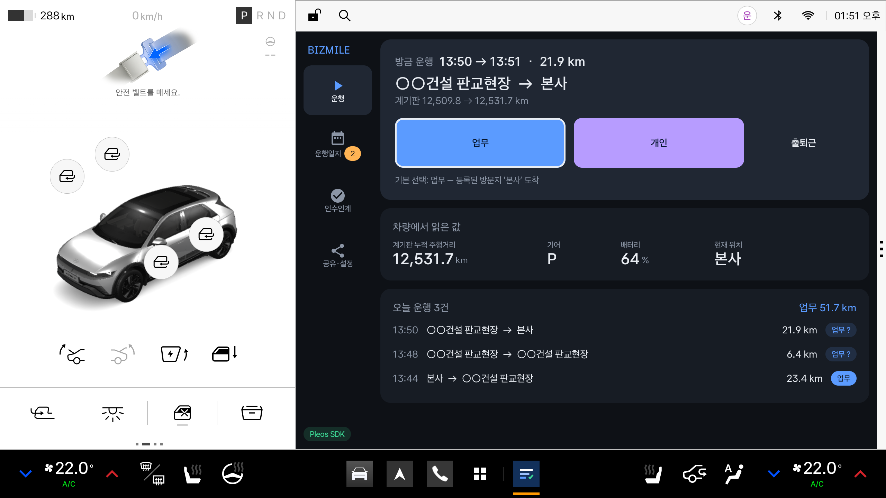
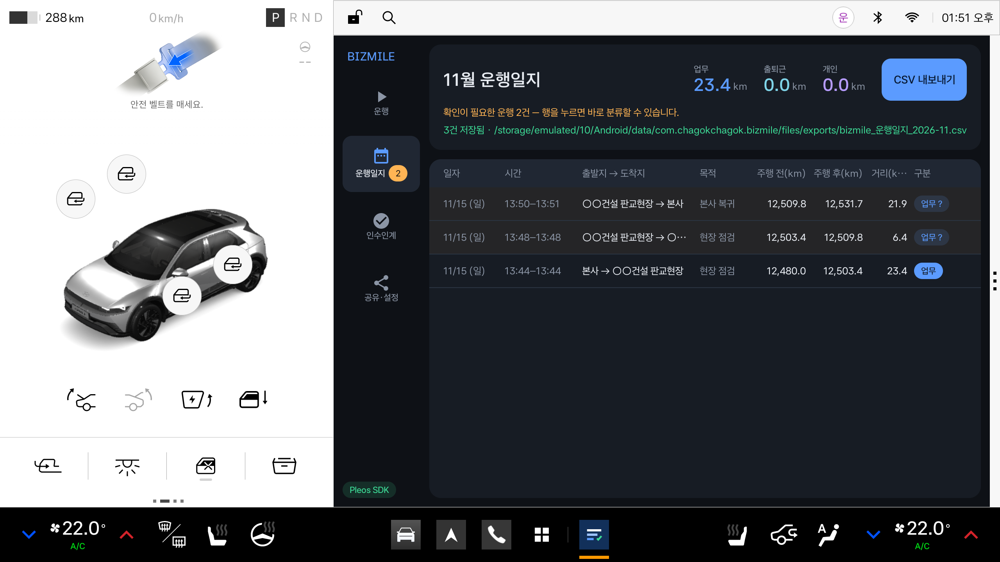
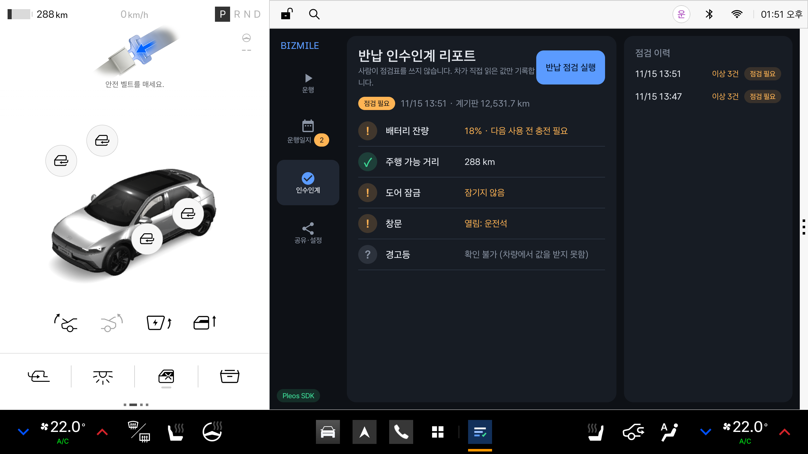
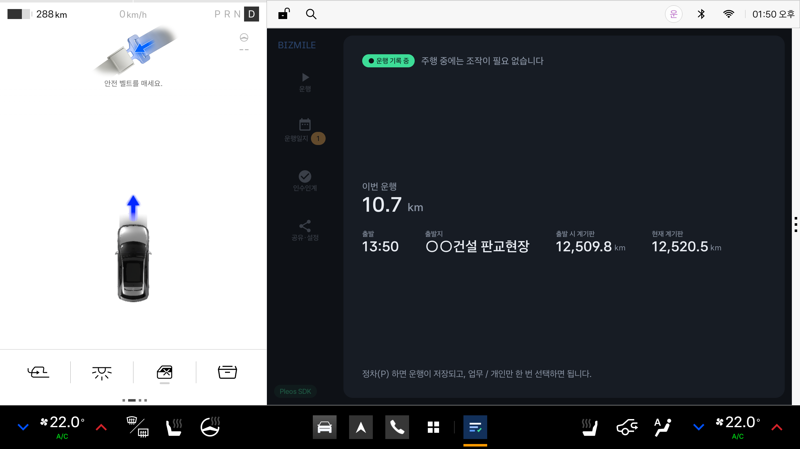

# 비즈마일 (BIZMILE)

**차가 스스로 쓰는 운행일지** — 기어와 계기판 주행거리로 운행을 자동 기록하고, 정차 후 `업무 / 개인` 한 번만 누르면 회사 제출용 운행일지가 완성됩니다. 반납할 때는 차가 직접 자기 상태를 점검해 다음 사용자에게 넘깁니다.

- 팀: **차곡차곡** · 현대자동차그룹 차량용 앱 개발 공모전 2026 (대학생 부문)
- 플랫폼: Pleos Connect (Android Automotive) · Kotlin · Jetpack Compose
- APK: [`apk/차곡차곡_비즈마일_release.apk`](apk/차곡차곡_비즈마일_release.apk)

## 이 저장소가 보여주는 것

기획서의 기능 중 **차 안에서만 가능한 부분**을 끝까지 동작하게 만든 프로토타입입니다.

| 단계 | 차에서 일어나는 일 | 사용하는 Pleos SDK |
|---|---|---|
| 1. 출발 | 기어 P → D 를 감지해 운행 시작, 계기판 누적거리와 출발 위치 저장 | `Gear.registerGearSelection`, `Odometer.registerDistanceDriven`, `FusedLocation` |
| 2. 주행 | 화면 조작 없음. 주행 중에는 조작할 수 없는 기록 화면만 표시 | `Odometer.registerDistanceDriven` |
| 3. 도착 | 기어 D → P 에 운행 종료, 주행 전/후 계기판 거리로 운행 1건 저장 | `Gear`, `Odometer` |
| 4. 분류 | 등록 방문지 규칙으로 자동 분류, 애매한 운행만 `업무 / 개인` 한 탭 | `FusedLocation` (방문지 매칭) |
| 5. 운행일지 | 월별 표(주행 전·후 계기판 km 포함)와 CSV 내보내기 | — |
| 6. 반납 | 차가 배터리·주행 가능 거리·도어 잠금·창문을 직접 읽어 인수인계 리포트 생성 | `EvBattery`, `Odometer`, `Door`, `Window` |

차량 데이터는 **읽기 전용**으로만 사용합니다. 제어(`CONTROL_*`) 권한은 요청하지 않습니다.

위 흐름은 Pleos Connect Emulator v2.1.0에서 Virtual Console로 값을 바꿔 가며 끝까지 확인했습니다.

| 정차 후 한 탭 분류 | 운행일지 |
|---|---|
|  |  |

| 반납 인수인계 리포트 | 주행 중 화면 (조작 잠금) |
|---|---|
|  |  |

### 아직 구현하지 않은 것

- **경고등·타이어 공기압**: Vehicle SDK 2.3.2에서 `Safety.getTelltalesInfo`와 `Tire.getTirePressure`는 비공개 권한(`PRIVATE_CAR_SAFETY`)을 요구해 일반 앱 권한으로는 읽을 수 없습니다. 그래서 인수인계 리포트의 경고등 항목은 `확인 불가`로 표시됩니다. 워셔액·오일 레벨은 공개 권한으로 요청하지만 에뮬레이터가 지원하지 않습니다.

- 법인차 상태 공유 서버·웹 대시보드·Teams 연동: 앱의 `공유·설정` 탭은 **공유될 내용의 미리보기**만 보여주며, 서버로 전송하지 않습니다.
- 내비게이션(ETA) 연동, 음성 메모(STT), 음성 안내(TTS), 사내 예약 연동
- 백그라운드 상시 기록: 지금은 앱 프로세스가 살아 있는 동안만 기록합니다. 부팅 시 자동 시작은 다음 단계입니다.
- Excel/PDF 내보내기: 현재는 Excel에서 열리는 CSV만 지원합니다.

## 실행 방법

### 1) APK 설치 (Pleos Connect Emulator)

```bash
adb install -r "apk/차곡차곡_비즈마일_release.apk"
adb shell am start -n com.chagokchagok.bizmile/.MainActivity
```

차량 값은 **Pleos Connect Virtual Console**에서 바꿉니다.

```bash
adb forward tcp:8088 tcp:8088     # 그다음 PC 브라우저에서 http://127.0.0.1:8088/
```

### 2) 데모 시나리오 (약 2분)

1. 앱 실행 → 위치 권한 요청에 `허용` → `운행` 탭에 계기판 누적거리·기어·배터리가 표시됩니다. 왼쪽 아래 표시가 `Pleos SDK`인지 확인합니다.
2. Virtual Console **Motion** 에서 기어를 `D` 로 → 앱이 `운행 기록 중` 화면으로 바뀌고 조작이 잠깁니다.
3. **Motion** 에서 주행 거리(Odometer)를 올립니다 → 화면의 이번 운행 km 가 따라 올라갑니다.
   도착지를 바꾸려면 `adb emu geo fix 127.1086 37.4020` (예시 방문지 ‘○○건설 판교현장’), 본사는 `adb emu geo fix 127.0276 37.4979`.
4. 기어를 `P` 로 → `방금 운행` 카드가 뜹니다. `업무` 또는 `개인` 을 한 번 누릅니다.
5. `운행일지` 탭 → 주행 전/후 계기판 km 가 채워진 표를 확인하고 `CSV 내보내기` 를 누릅니다.
6. Virtual Console 에서 배터리를 30% 아래로 낮추거나 창문을 열고(도어 잠금 해제 포함), `인수인계` 탭 → `반납 점검 실행` → `점검 필요` 리포트를 확인합니다.

### 3) 소스에서 빌드

```bash
./gradlew testDebugUnitTest      # 운행 분할·분류·인수인계·내보내기 단위 테스트
./gradlew assembleRelease        # app/build/outputs/apk/release/app-release.apk
```

release 서명은 저장소에 없는 `keystore.properties`(`storeFile`, `storePassword`, `keyAlias`, `keyPassword`)에서 읽습니다. 파일이 없으면 디버그 키로 서명되어 빌드는 그대로 됩니다.

## 테스트 환경 및 필수 설정

| 항목 | 값 |
|---|---|
| Pleos Connect Emulator | **v2.1.0** (`RELEASE.release_connect_v2.1.0`), Android 14 (API 34), x86_64 |
| 화면 규격 | **2560 × 1440**, 160 dpi (mdpi), 12.8형 가로 — AVD 기기 정의 `Pleos Connect v2.1.0` |
| Vehicle SDK / FusedLocation SDK | 2.3.2 / 1.1.3 (`https://nexus-playground.pleos.ai/repository/maven-releases/`) |
| 앱 | minSdk 28, targetSdk 34, compileSdk 35 |
| 빌드 | JDK 17, Gradle 8.10.2, Android Gradle Plugin 8.8.2, Kotlin 2.0.21 |
| 필수 설정 | Virtual Console 사용 시 `adb forward tcp:8088 tcp:8088`, 첫 실행 시 위치 권한 허용 |

선언한 권한: `pleos.car.permission.CAR_DRIVE`, `CAR_ENERGY`, `CAR_INFO`, `CAR_DOORS`, `CAR_WINDOWS`, `CAR_SAFETY`, `FUSED_LOCATION`

### Pleos Vehicle Service 가 없는 기기에서는

일반 Android 에뮬레이터나 휴대전화에 설치하면 앱이 이를 감지해 **시뮬레이션 데이터**로 동작하고, 화면에 `시뮬레이션` 표시와 개발용 시뮬레이터 패널(기어·거리·배터리·경고등 조작, 운행 재생)이 나타납니다. 시뮬레이션으로 만든 운행은 운행일지에 `시뮬` 로 표시되어 실제 차량 데이터와 구분됩니다.

## 구조

```
app/src/main/java/com/chagokchagok/bizmile/
├─ vehicle/    VehicleDataSource (인터페이스)
│              ├─ PleosVehicleDataSource      Pleos Vehicle SDK + FusedLocation SDK
│              └─ SimulatedVehicleDataSource  차량 서비스가 없을 때의 대체 입력
├─ trip/       TripSegmenter (운행 분할 상태 기계), TripClassifier (자동 분류 규칙), TripRecorder
├─ handover/   HandoverInspector (반납 점검)
├─ data/       Room: trips · places · handovers
├─ export/     TripLogExporter (운행일지 CSV)
└─ ui/         Compose 화면: 운행 · 운행일지 · 인수인계 · 공유·설정
```

**운행 분할** (`TripSegmenter`)

```
IDLE ──(기어 P 이탈 또는 계기판 증가)──▶ DRIVING ──(기어 P)──▶ STOPPED
STOPPED ──(10분 안에 재출발: 주유·편의점)──▶ DRIVING   같은 운행, 경유 +1
STOPPED ──(10분 경과 또는 운전자가 분류)──▶ IDLE
```

기어 신호가 없는 차량에서는 계기판 거리만으로 동작합니다(증가하면 시작, 3분간 변화 없으면 종료). 신호 대기처럼 기어가 D 인 채 멈춘 것은 운행 종료로 보지 않습니다. 거리가 0.1 km 미만인 이동(주차 위치 조정)은 버립니다.

**자동 분류** (`TripClassifier`) — "애매한 것만 묻기"

| 조건 | 결과 |
|---|---|
| 집 ↔ 근무지, 평일 | 출퇴근으로 자동 분류 |
| 등록된 방문지에 도착 | 그 방문지의 기본 구분을 미리 선택 → 한 탭으로 확인 |
| 미등록 장소 · 위치 수신 안 됨 | 운전자에게 확인 |

**차에서 받지 못한 값은 추측하지 않습니다.** 인수인계 리포트에서 차량이 주지 않은 항목은 정상이 아니라 `확인 불가`로 표시됩니다.

## 개인정보

- 운행 기록은 기기 내부(Room)에만 저장되며, 이 빌드는 어떤 서버로도 데이터를 보내지 않습니다(`INTERNET` 권한 없음).
- 공유 미리보기에는 정확한 좌표와 이동 경로가 들어가지 않고, 등록 장소 이름·운행 상태·배터리·경고등만 들어갑니다.
